<p align="center">
  <b>🇺🇸 English</b> &nbsp;|&nbsp; <a href="https://github.com/lorenzomarcal/lorenzomarcal/tree/main/pt-BR">🇧🇷 Português</a>
</p>

<!-- ===================== HEADER ===================== -->
<p align="center">
  
</p>

<p align="center">
  <a href="https://github.com/lorenzomarcal">
    
  </a>
</p>

<p align="center">
  <a href="mailto:lorenzomaarcal03@gmail.com"></a>
  <a href="https://github.com/lorenzomarcal"></a>
  
</p>

<br/>

<p align="center">
  
</p>

<br/>

<!-- ===================== ABOUT ===================== -->
## 🧑‍💻 About me

```python
class Lorenzo:
    def __init__(self):
        self.name     = "Lorenzo Marçal"
        self.role     = "Back-end Student"
        self.location = "Guarulhos-SP, Brazil"
        self.learning = ["Python", "JavaScript", "PostgreSQL", "Docker",
                         "REST APIs", "Security", "Automation", "AI"]
        self.business = "I build websites for local businesses"
        self.goal     = "Build secure and scalable back-end systems"

    def motto(self):
        return "Learn by building — one project at a time."
```

- 🎯 **Current focus:** mastering back-end with **Python**, building APIs backed by **PostgreSQL** and running on **Docker**
- 💼 **Hands-on:** I already deliver **websites for local businesses** (gym, dental clinic, car dealership, 3D printing)
- ⚙️ **Special interest:** process automation and **artificial intelligence** applied to real systems
- 📫 **Reach me:** [lorenzomaarcal03@gmail.com](mailto:lorenzomaarcal03@gmail.com)

<br/>

<!-- ===================== STACK ===================== -->
## 🛠️ Stack

<table align="center">
  <tr>
    <td align="center" width="170"><b>Languages</b></td>
    <td></td>
  </tr>
  <tr>
    <td align="center"><b>Back-end & APIs</b></td>
    <td></td>
  </tr>
  <tr>
    <td align="center"><b>Databases</b></td>
    <td></td>
  </tr>
  <tr>
    <td align="center"><b>DevOps & tools</b></td>
    <td></td>
  </tr>
  <tr>
    <td align="center"><b>Front-end (websites)</b></td>
    <td></td>
  </tr>
</table>

<br/>

<!-- ===================== ROADMAP ===================== -->
## 🗺️ Learning roadmap

> My path to becoming a back-end developer. Updated as I progress — ✅ done · 🟡 in progress · 🔵 studying · ⚪ up next

| | Step | What I'm learning | Status |
|:-:|---|---|:-:|
| 🐍 | **Python** | Logic, functions, OOP, virtual environments | 🟡 |
| 🟨 | **JavaScript** | Fundamentals, async, Node.js | 🟡 |
| 🌿 | **Git & GitHub** | Commits, branches, pull requests | 🟡 |
| 🐘 | **PostgreSQL** | Data modeling, SQL, relationships, indexes | 🔵 |
| 🔌 | **REST APIs** | FastAPI, routing, validation, documentation | 🔵 |
| 🐳 | **Docker** | Images, containers, Docker Compose | 🔵 |
| 🔐 | **Security** | Authentication, JWT, password hashing, OWASP Top 10 | 🔵 |
| ⚙️ | **Automation** | Scripts, integrations, scheduled jobs | 🔵 |
| 🤖 | **AI** | LLM APIs and AI applied to the back-end | 🔵 |
| 🚀 | **Deploy & CI/CD** | Automated tests, GitHub Actions, cloud | ⚪ |

<br/>

<!-- ===================== PROJECTS ===================== -->
## 🚀 Projects

<table>
  <tr>
    <td width="50%" valign="top">
      <h3>🌐 Websites for local businesses</h3>
      <p>Custom websites for small businesses: a gym, a dental clinic, a car dealership and a 3D printing shop.</p>
      <p>
        
        
        
        
      </p>
    </td>
    <td width="50%" valign="top">
      <h3>🔨 Up next: Python API</h3>
      <p>A complete REST API with authentication, a database and containers — the project that ties together everything I'm learning.</p>
      <p>
        
        
        
        
      </p>
    </td>
  </tr>
</table>

<br/>

<!-- ===================== ACTIVITY ===================== -->
## 📊 GitHub activity

<p align="center">
  
</p>

<p align="center">
  <picture>
    <source media="(prefers-color-scheme: dark)" srcset="https://raw.githubusercontent.com/lorenzomarcal/lorenzomarcal/output/github-snake-dark.svg" />
    <source media="(prefers-color-scheme: light)" srcset="https://raw.githubusercontent.com/lorenzomarcal/lorenzomarcal/output/github-snake.svg" />
    
  </picture>
</p>

<br/>

<!-- ===================== CONTACT ===================== -->
## 🤝 Let's talk

<p align="center">
  I'm open to exchanging ideas, collaborating on projects and talking about <b>back-end</b>, <b>automation</b> and <b>AI</b>.
</p>

<p align="center">
  <a href="mailto:lorenzomaarcal03@gmail.com"></a>
  <a href="https://github.com/lorenzomarcal?tab=repositories"></a>
</p>

<p align="center"><i>"Every expert was once a beginner."</i> 💙</p>


