<p align="center">
  <a href="https://github.com/lorenzomarcal">🇺🇸 English</a> &nbsp;|&nbsp; <b>🇧🇷 Português</b>
</p>

<!-- ===================== CABEÇALHO ===================== -->
<p align="center">
  
</p>

<p align="center">
  <a href="mailto:lorenzomaarcal03@gmail.com"></a>
  <a href="https://github.com/lorenzomarcal"></a>
  
</p>

<br/>

<p align="center">
  
</p>

<br/>

<!-- ===================== SOBRE MIM ===================== -->
## 🧑‍💻 Sobre mim

```python
class Lorenzo:
    def __init__(self):
        self.nome      = "Lorenzo Marçal"
        self.papel     = "Estudante de Back-end"
        self.local     = "Guarulhos-SP, Brasil"
        self.estudando = ["Python", "JavaScript", "PostgreSQL", "Docker",
                          "APIs REST", "Segurança", "Automação", "IA"]
        self.negocio   = "Crio sites para negócios locais"
        self.objetivo  = "Construir sistemas back-end seguros e escaláveis"

    def lema(self):
        return "Aprender construindo — um projeto de cada vez."
```

- 🎯 **Foco atual:** dominar o back-end com **Python**, criando APIs com banco de dados **PostgreSQL** rodando em **Docker**
- 💼 **Na prática:** já entrego **sites para negócios locais** (academia, clínica odontológica, revenda de veículos, impressão 3D)
- ⚙️ **Interesse especial:** automação de processos e **inteligência artificial** aplicada a sistemas
- 📫 **Fale comigo:** [lorenzomaarcal03@gmail.com](mailto:lorenzomaarcal03@gmail.com)

<br/>

<!-- ===================== TECNOLOGIAS ===================== -->
## 🛠️ Stack

<table align="center">
  <tr>
    <td align="center" width="170"><b>Linguagens</b></td>
    <td></td>
  </tr>
  <tr>
    <td align="center"><b>Back-end & APIs</b></td>
    <td></td>
  </tr>
  <tr>
    <td align="center"><b>Banco de dados</b></td>
    <td></td>
  </tr>
  <tr>
    <td align="center"><b>DevOps & ferramentas</b></td>
    <td></td>
  </tr>
  <tr>
    <td align="center"><b>Front-end (sites)</b></td>
    <td></td>
  </tr>
</table>

<br/>

<!-- ===================== TRILHA ===================== -->
## 🗺️ Trilha de estudos

> Minha rota para virar dev back-end. Atualizo conforme avanço — ✅ concluído · 🟡 em andamento · 🔵 estudando · ⚪ próximo

| | Etapa | O que estou aprendendo | Status |
|:-:|---|---|:-:|
| 🐍 | **Python** | Lógica, funções, POO, ambientes virtuais | 🟡 |
| 🟨 | **JavaScript** | Fundamentos, assíncrono, Node.js | 🟡 |
| 🌿 | **Git & GitHub** | Commits, branches, pull requests | 🟡 |
| 🐘 | **PostgreSQL** | Modelagem, SQL, relacionamentos, índices | 🔵 |
| 🔌 | **APIs REST** | FastAPI, rotas, validação, documentação | 🔵 |
| 🐳 | **Docker** | Imagens, containers, Docker Compose | 🔵 |
| 🔐 | **Segurança** | Autenticação, JWT, hash de senhas, OWASP Top 10 | 🔵 |
| ⚙️ | **Automação** | Scripts, integrações, tarefas agendadas | 🔵 |
| 🤖 | **IA** | APIs de LLM e IA aplicada ao back-end | 🔵 |
| 🚀 | **Deploy & CI/CD** | Testes automatizados, GitHub Actions, nuvem | ⚪ |

<br/>

<!-- ===================== PROJETOS ===================== -->
## 🚀 Projetos

<table>
  <tr>
    <td width="50%" valign="top">
      <h3>💰 <a href="https://github.com/lorenzomarcal/FinanceApp">FinanceApp</a></h3>
      <p>Controle financeiro pessoal com carteira de investimentos e cotação real da B3 — meu primeiro projeto back-end completo.</p>
      <p>
        
        
      </p>
    </td>
    <td width="50%" valign="top">
      <h3>🌐 Sites para negócios locais</h3>
      <p>Sites institucionais sob medida para pequenos negócios: academia, clínica odontológica, revenda de veículos e impressão 3D.</p>
      <p>
        
        
        
        
      </p>
    </td>
  </tr>
</table>

<br/>

<!-- ===================== ESTATÍSTICAS ===================== -->
## 📊 Atividade no GitHub

<p align="center">
  
</p>

<p align="center">
  <picture>
    <source media="(prefers-color-scheme: dark)" srcset="https://raw.githubusercontent.com/lorenzomarcal/lorenzomarcal/output/github-snake-dark.svg" />
    <source media="(prefers-color-scheme: light)" srcset="https://raw.githubusercontent.com/lorenzomarcal/lorenzomarcal/output/github-snake.svg" />
    
  </picture>
</p>

<br/>

<!-- ===================== CONTATO ===================== -->
## 🤝 Vamos conversar?

<p align="center">
  Estou aberto a trocar ideias, colaborar em projetos e conversar sobre <b>back-end</b>, <b>automação</b> e <b>IA</b>.
</p>

<p align="center">
  <a href="mailto:lorenzomaarcal03@gmail.com"></a>
  <a href="https://github.com/lorenzomarcal?tab=repositories"></a>
</p>

<p align="center"><i>"Todo especialista já foi um iniciante."</i> 💙</p>

<!-- ===================== RODAPÉ ===================== -->
<p align="center">
  
</p>
